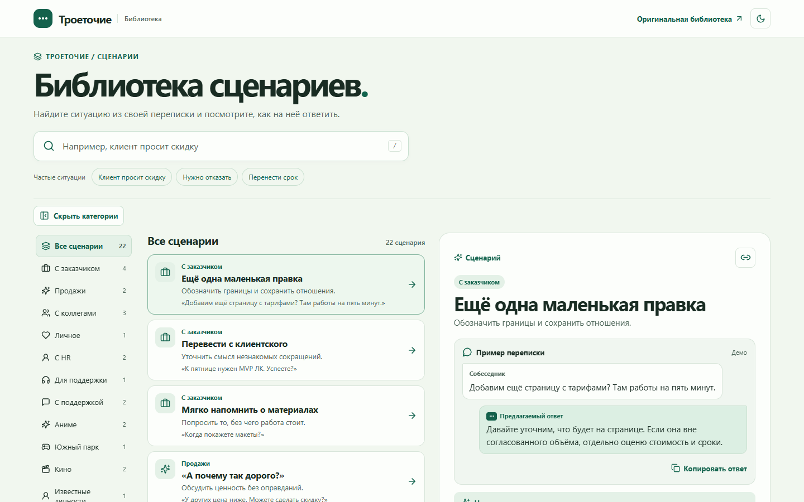

# Библиотека сценариев «Троеточия»

Независимый концепт интерфейса для отклика на позицию Frontend-разработчика. Официальный продукт и его библиотека принадлежат команде «Троеточия».

[Открыть демо](https://evgesha-cpu.github.io/troetochie-scenarios-redesign/) · [Прямая ссылка на пример](https://evgesha-cpu.github.io/troetochie-scenarios-redesign/?scenario=price) · [Официальная библиотека](https://troetochie.com/scenarios/)

## Что изменилось

| Уже есть в оригинале | UX в концепте |
| --- | --- |
| Поиск, 12 категорий и 22 сценария | Поиск на первом экране, быстрые запросы по ситуации, количество результатов, совместное применение фильтров |
| Карточки с входящим сообщением и ответом | В списке остаётся короткая реплика, полный диалог читается в отдельной области |
| Подробности сценария в диалоге и прямые ссылки | На широком экране каталог остаётся рядом. На узком экране подробности занимают всю рабочую область, а возврат восстанавливает контекст |
| Копирование ответа и обмен ссылками | Действия доступны рядом с примером и заголовком, результат подтверждается текстом |
| Установка на Mac, скачивание настроек, ручной перенос | Кнопка заранее объясняет переход на официальный экран установки, управляющий этими действиями |

Сравнивались отдельная страница, диалог поверх каталога и встроенная область просмотра. Отдельная страница удобна на мобильном экране, но на десктопе требует чаще возвращаться к списку. Диалог подходит для краткого чтения, однако перекрывает каталог. Встроенный просмотр позволяет оценить несколько сценариев подряд и показать пример уже при первом открытии библиотеки. Порог переключения выбран на 900 px, чтобы на узких экранах сохранить удобную ширину сообщений.

## Скриншоты

| Экран | Оригинал | Концепт |
| --- | --- | --- |
| Десктоп | [1440 px](docs/screenshots/original-1440.png) | [1440 px](docs/screenshots/redesign-1440.png) |
| Мобильный | [390 px](docs/screenshots/original-390.png) | [390 px](docs/screenshots/redesign-390.png) |
| Тёмная тема | | [1440 px](docs/screenshots/redesign-dark-1440.png) |
| Сценарий | [Диалог оригинала](docs/screenshots/original-detail.png) | [Мобильный экран](docs/screenshots/redesign-mobile-detail.png) |



## Локальный запуск

Node.js 22 LTS и npm. Playwright настроен на установленный Google Chrome.

```sh
npm install
npm run dev
```

```sh
npm run lint
npm run typecheck
npm run build
npm run test:e2e
```

Тесты запускают preview production-сборки. Чтобы переснять оригинал, запустите `node scripts/capture-original.mjs` с доступом к официальному сайту.

## Устройство проекта

Панель категорий сворачивается влево. На мобильном она открывается поверх списка и закрывается после выбора. Переключатель темы сохраняет выбор в браузере, а при первом посещении учитывает системную настройку.

- `public/scenarios.json` содержит 22 реальные позиции с исходными идентификаторами, категориями, названиями и зарегистрированным в каталоге тоном. Тексты макета, включая примеры переписки, отредактированы для концепта по мотивам соответствующих оригинальных примеров. На каждый оригинал есть отдельная ссылка.
- `src/library.ts` проверяет ответ статического HTTP-запроса к JSON, отменяет устаревший запрос, обрабатывает неуспешный ответ и применяет поиск по словам и ключевым фразам. Пользователь видит состояния загрузки, ошибки с повтором, пустого результата и успеха.
- `src/main.tsx` содержит навигацию, состояние URL, фильтры и каталог. `src/ScenarioDetail.tsx` отвечает за представление сценария и копирование. Ссылка `?scenario=...` открывается на GitHub Pages без перенаправлений и серверной маршрутизации. Параметры `q` и `category` сохраняют контекст каталога в текущем URL. Ссылка из кнопки «Поделиться» содержит только идентификатор сценария.
- `tests/library.spec.ts` проверяет пользовательские действия, состояния загрузки, работу клавиатуры, историю и раскладку на 360, 390, 768, 1024 и 1440 px. Публикацией управляет GitHub Actions.

## Источники и границы

Изучены главная страница, каталог, опубликованные данные, несколько отдельных сценариев и публичный канал. Предоставленный снимок окна настроек использован как ориентир для компактных элементов. Файл и сведения из окна настроек в репозиторий не включены. [Главная страница](https://troetochie.com/) · [Каталог](https://troetochie.com/scenarios/) · [Данные каталога](https://troetochie.com/for-clients/catalog.json) · [Канал](https://t.me/rustem_hacks)

Страница лицензий описывает сторонние компоненты продукта. Исходный код и графические ресурсы продукта в реализации не используются. Скриншоты оригинала приведены для сравнения интерфейсов с указанием источника. [Страница лицензий](https://troetochie.com/licenses/)

На официальной странице установка по ссылке предусмотрена для macOS с версии 0.3.120. Там же доступно скачивание файла, а для ссылок-приглашений оригинал может предложить файл в качестве основного действия. На других платформах оригинал описывает ручной перенос пожеланий. Концепт открывает эту страницу и не вызывает обработчик приложения напрямую. Playwright проверяет веб-переход и не выполняет установку в приложении.

Подсказки подготовлены заранее. Поиск обрабатывается в браузере, запрос отражается в адресе страницы. Сохранение переданного поискового запроса за пределами адресной строки и истории зависит от браузера и хостинга. Замеров конверсии и времени выполнения задачи с реальными пользователями не проводилось.
